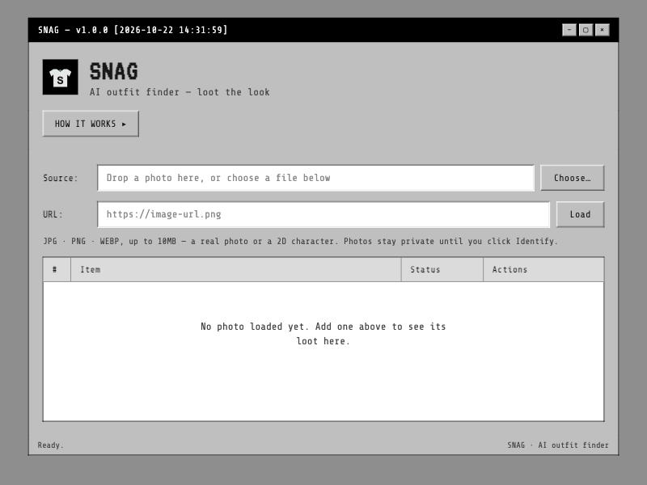

# SNAG — Loot the Look

**Upload a photo of any outfit, real or a 2D character, and SNAG names every piece of it, ready to shop.**

**Live:** https://snag-outfit-finder.vercel.app



## What it does

1. You drop in a photo, pick a file, or paste an image URL (JPG, PNG or WEBP, up to 10MB).
2. SNAG sends the image to the Claude vision API with a prompt that asks for every clothing item and accessory.
3. Each item comes back as structured data: category, a short description, its main color, and a search phrase you could paste into a store's search bar.

> **Launch status:** detection is built and working, but the public site currently shows a waitlist instead of running it, so no paid API calls happen while I gauge interest. Run it locally with your own API key to try the real detection.

## Features

- **Image input three ways:** drag and drop, file picker, or image URL, with type and size checks before anything is sent.
- **AI outfit detection:** the server turns the model's reply into a clean list of items and ignores anything that isn't clothing (skin, hair, background).
- **Waitlist gate:** an email signup (Formspree) stands in for detection until launch.
- **Installable web app:** a web manifest and service worker let you add SNAG to your home screen, and the app shell loads offline.
- **Responsive retro UI:** a hand-built desktop-window design with no CSS framework, reworked for phone screens.
- **Privacy:** photos stay in the browser until you click Identify.

## Tech stack

| Layer | Tools |
| --- | --- |
| Frontend | HTML, CSS, vanilla JavaScript (no framework) |
| Backend | Node.js, Express (local), Vercel serverless function (production) |
| AI | Anthropic Claude Messages API with image input |
| Hosting | Vercel |
| Other | Formspree (waitlist), Cloudflare Web Analytics |

## How it's built

```
public/              static frontend served as-is
  index.html         the whole UI: markup, styles and client script
  sw.js              service worker (caches the app shell)
  manifest.webmanifest
api/analyze.js       Vercel serverless endpoint: POST /api/analyze
lib/analyzeOutfit.js shared logic: builds the Claude request, parses the reply
server.js            Express server for local development (same endpoint)
```

The detection logic lives in one shared module, `lib/analyzeOutfit.js`, used by both the local Express server and the Vercel function, so development and production behave the same. The API key stays on the server and is never sent to the browser.

## Run it locally

You need Node.js 18 or newer and an [Anthropic API key](https://console.anthropic.com/).

```bash
git clone https://github.com/edvargas521/snag-outfit-finder.git
cd snag-outfit-finder
npm install
cp .env.example .env     # then put your key in ANTHROPIC_API_KEY
npm start                # http://localhost:3000
```

To use real detection instead of the waitlist, change the Identify button's click handler in `public/index.html` to call `identifyOutfit()`; the comment above it marks the spot.

Optional: set `ANTHROPIC_MODEL` in `.env` to choose a different Claude model.

## Roadmap

- Turn on live detection for the public site
- Link each item to shopping results with prices
- Save past looks
